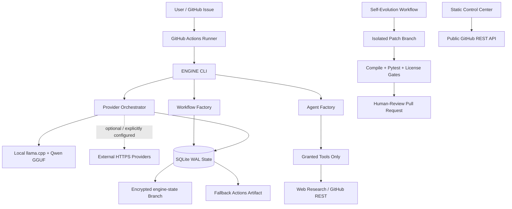

# ENGINE — GitHub-Native Autonomous Agent & Workflow Engine

[](https://www.python.org/)
[](https://github.com/ggml-org/llama.cpp)
[](https://github.com/zopair/Engine-/releases/tag/models-v1)
[](#proof-of-concept--enterprise-customization-readiness)

**ENGINE is a GitHub-native agent and workflow execution framework built around ephemeral GitHub Actions runners, a small local GGUF model, SQLite-backed state, constrained tool access, and human-reviewed self-evolution pull requests.**

The design avoids permanent servers and paid inference by default. The local Qwen model is stored as a GitHub Release asset and provisioned with SHA-256 verification. External OpenAI-compatible providers are opt-in only and are not assumed to be free.

## 1. Project Overview & Problem Statement

Agent prototypes often lose context between runs, depend on permanent infrastructure, or allow model-generated changes to bypass engineering review. ENGINE explores a different operating model: use GitHub Actions as temporary execution workers, persist only bounded state, and keep all proposed code changes isolated until CI passes and a human reviews them.

Core capabilities in the repository:

- Task intake through GitHub Issues with the `[TASK]` prefix, manual workflow dispatch, and scheduled maintenance.
- A local CPU inference adapter for a checksum-verified Qwen2.5-0.5B GGUF model.
- Optional, explicitly configured OpenAI-compatible providers with health-aware routing and SQLite performance history.
- SQLite WAL storage for conversations, user facts, knowledge, semantic cache, and resumable workflow runs.
- Agent and workflow factories with capability-scoped tool access and resumable steps.
- Web research and GitHub repository tools with bounded inputs and network restrictions.
- Encrypted SQLite persistence to a dedicated `engine-state` branch, plus a non-encrypted Actions Artifact fallback.
- A self-evolution workflow that proposes bounded patches on isolated branches and opens a PR only after tests and license checks pass.
- A static GitHub Pages control-center source for task and workflow telemetry.

### Architecture



**Operating boundary:** GitHub Actions are temporary workers, not a permanently running service. Scheduled workflows run at their configured intervals; they do not provide continuous availability or guaranteed immediate execution.

## 2. Tech Stack & Versions

| Layer | Technology |
|---|---|
| Runtime | Python 3.11 |
| Default runtime dependencies | Python standard library; root `requirements.txt` intentionally contains no third-party runtime packages |
| Local inference | Official llama.cpp CPU CLI build b12503, installed with checksum verification |
| Model | Qwen2.5-0.5B-Instruct Q4_K_M GGUF, Apache-2.0 model metadata |
| Model distribution | GitHub Release `models-v1` plus SHA-256 sidecar |
| Persistent data | SQLite with WAL, backup API, and optional encrypted GitHub branch storage |
| Agent/workflow execution | Python factories, JSON tool plans, bounded task execution |
| CI / orchestration | GitHub Actions, GitHub CLI, GitHub REST API |
| Test tooling | pytest 9.0.3 and pinned development dependencies |
| Static UI | Vanilla HTML/CSS/JavaScript in `docs/index.html`; GitHub Pages workflow |

### License policy

- Runtime dependencies are restricted to MIT, Apache-2.0, and BSD-3-Clause.
- Development/test dependencies may additionally use the documented Pygments BSD-2-Clause exception.
- `requirements-dev.txt` pins pytest and its direct supporting packages.
- The runtime license check and development license check are separate CI gates.
- No root `LICENSE` file was present in the reviewed repository tree; project redistribution terms remain to be selected.

## 3. Prerequisites & Dependencies

### For local development and tests

- Git.
- Python 3.11.
- OpenSSL for the encrypted-state codec.
- pytest and the pinned development packages from `requirements-dev.txt`.

### For real local inference

- A compatible CPU runner.
- The pinned llama.cpp CLI runtime.
- The Qwen GGUF model from the `models-v1` GitHub Release.
- Enough memory for the model plus runtime reserve; ENGINE applies configured memory and CPU-thread limits.

### For GitHub Actions operation

- A GitHub repository with Actions enabled and the required workflow permissions.
- The repository-scoped `GITHUB_TOKEN` supplied by Actions.
- Optional repository secret `ENGINE_STATE_ENCRYPTION_KEY` for encrypted branch persistence.
- Optional repository variables for an approved model URL/checksum or explicitly approved external providers.

No Docker daemon, hosted GPU, Hugging Face Space, permanent server, or paid API is required for the default CPU inference path.

## 4. Installation & Local Setup

Clone the repository:

```bash
git clone https://github.com/zopair/Engine-.git
cd Engine-
```

Create a virtual environment and install development dependencies:

```bash
python3.11 -m venv .venv
source .venv/bin/activate
python -m pip install --disable-pip-version-check --no-deps -r requirements.txt -r requirements-dev.txt
```

Run the full test suite and compile check:

```bash
python -m compileall -q cli.py core memory agents factories tools scripts evolution
pytest -q
python scripts/check_licenses.py --scope dev
```

### Provision local CPU inference

The model is distributed through the repository's GitHub Release, not downloaded from a public model host on every run:

```bash
python scripts/install_llama_runtime.py
python scripts/provision_model.py
```

The provisioner accepts only HTTPS GitHub Release asset URLs, validates the release checksum sidecar or explicit SHA-256, checks redirect hosts, limits the asset to 700 MiB, and verifies the digest before installing the file.

Then run a task:

```bash
python cli.py run "Summarize the current repository architecture and identify one testable improvement"
```

Initialize/inspect maintenance state:

```bash
python cli.py maintenance
```

### GitHub Actions operation

- Open an Issue whose title begins with `[TASK]` to submit a task.
- Or run `ENGINE Runner` manually with a task input.
- The scheduled runner invokes bounded maintenance every six hours.
- Successful task Issues are commented on and closed; failed tasks remain open.
- The runner uses a concurrency group to prevent overlapping state writes.

## 5. Environment Variables

| Variable | Purpose |
|---|---|
| `ENGINE_MODEL_PATH` | Local GGUF model path |
| `ENGINE_MODEL_RELEASE_URL` | Approved GitHub Release asset URL; defaults to `models-v1` |
| `ENGINE_MODEL_SHA256` | Optional pinned model SHA-256 override; otherwise the Release sidecar is read |
| `ENGINE_THREADS`, `ENGINE_MAX_CPU_THREADS` | CPU inference thread limits |
| `ENGINE_MAX_MEMORY_MB` | Maximum model/runtime memory budget |
| `ENGINE_CONTEXT`, `ENGINE_BATCH`, `ENGINE_MAX_TOKENS`, `ENGINE_TEMPERATURE` | Local inference parameters |
| `ENGINE_DATABASE_PATH` | SQLite state database path |
| `ENGINE_HUEY_DATABASE_PATH` | Optional task-queue database path |
| `ENGINE_STATE_ENCRYPTION_KEY` | Secret of at least 32 bytes for encrypted state persistence |
| `ENGINE_PUBLIC_PROVIDERS` | JSON array of explicitly approved OpenAI-compatible HTTPS endpoints |
| `GROQ_API_KEY`, `GEMINI_API_KEY`, `OPENROUTER_API_KEY` | Optional provider credentials referenced by configured provider entries |
| `ENGINE_API_KEY` | Reserved API configuration setting; API authentication is not yet a complete supported service |
| `SEARXNG_URL`, `CRAWL_TIMEOUT_SECONDS` | Optional research configuration |
| `MEM0_ENABLED`, `SEMANTIC_CACHE_ENABLED`, `EMBEDDING_MODEL`, `SEMANTIC_SIMILARITY_THRESHOLD` | Optional memory/cache configuration |
| `DSPY_MODEL` | Optional DSPy prompt-optimization model setting |
| `GITHUB_TOKEN`, `GITHUB_REPOSITORY` | Supplied by GitHub Actions for repository operations |

### Zero-cost configuration rule

Leave `ENGINE_PUBLIC_PROVIDERS` and all provider API keys unset to use only the local GGUF model. Configuring an external endpoint can incur charges or data-processing obligations; the repository does not guarantee that any third-party endpoint is free.

If no valid local model/runtime or approved provider is available, ENGINE should fail clearly rather than claim a task completed.

Never commit `ENGINE_STATE_ENCRYPTION_KEY`, provider credentials, GitHub tokens, or private task data.

## 6. Usage Guide & Core Features

### A. Local model and provider orchestration

- `core/local_engine.py` supports an injected llama-cpp Python binding or the audited llama.cpp CLI.
- The CLI path forces CPU operation and enforces memory, thread, and request-time limits.
- `core/provider_orchestrator.py` discovers the local model and any explicitly configured HTTPS providers.
- Provider health, latency, success/failure metrics, and request IDs are tracked in SQLite.
- Fallback is bounded; the same provider is not retried repeatedly in the same request.
- No third-party provider is automatically assumed trustworthy, free, or available.

### B. Memory and workflow persistence

- `memory/database.py` stores conversation, fact, cache, knowledge, and workflow state in SQLite WAL.
- `memory/knowledge_store.py` provides bounded local vector retrieval using a deterministic CPU hashing embedder.
- `factories/workflow_factory.py` persists workflow steps, outputs, leases, and resumable state.
- `memory/state_store.py` encrypts database snapshots with AES-256-CBC plus HMAC and commits them to the dedicated `engine-state` branch.
- The optional artifact fallback snapshots SQLite using the backup API and validates database integrity before upload.

**Security boundary:** the artifact fallback is not application-encrypted. Use it only for data whose sensitivity is acceptable under the repository's GitHub Actions artifact access controls. Use the encrypted branch path for sensitive state and keep the key in GitHub Secrets.

### C. Agent and tool factories

- `factories/agent_factory.py` creates agents with explicit tool grants.
- Model-proposed tool calls must use only granted tool names.
- The current executor bounds a tool round to four calls and deduplicates identical calls.
- Tool outputs are passed back as untrusted data, not as instructions.
- `factories/workflow_factory.py` provides resumable, checkpointed workflows with bounded step counts and execution leases.

### D. Web research and repository tools

- `tools/web_research.py` searches public HTML and extracts bounded Markdown using the Python standard library.
- URL normalization and DNS checks reject local/private network targets; redirect destinations are checked again.
- `tools/repo_tools.py` scopes GitHub REST calls to the configured repository and supports Issues, branch creation, and state operations.

### E. Self-evolution

The self-evolution workflow:

1. Reads provider metrics and recent request activity from SQLite.
2. Requests one evidence-based patch from an available inference provider.
3. Rejects patches outside approved source/test directories, over 80 KB, over eight files, or without a regression test.
4. Creates an isolated branch.
5. Runs compile, pytest, and development license gates.
6. Opens a pull request only after every gate succeeds.

Self-evolution does not merge its own PR. Human review and manual merge remain required. It cannot modify workflows, dependencies, license policy, docs, or credentials.

### F. Static control center

[`docs/index.html`](docs/index.html) is a dependency-free UI that reads public GitHub Issues and Actions metadata and links task creation to GitHub's issue form. It does not store a GitHub token in the browser and does not expose private SQLite contents.

The `pages.yml` workflow is configured to publish `docs/` using GitHub Pages. A recent successful Pages deployment was not confirmed during this review.

### G. API scaffold boundary

The `api/` directory contains a small FastAPI health/chat scaffold. FastAPI is not declared in the root runtime requirements, and the current route set is not a complete production API or media service. Treat it as an unfinished extension, not as an available hosted endpoint.

## 7. Live Demo & Screenshots

ENGINE is primarily a GitHub Actions execution platform, not a permanently hosted application.

- **Model release:** [models-v1 — approved Qwen GGUF assets](https://github.com/zopair/Engine-/releases/tag/models-v1)
- **Static control-center source:** [docs/index.html](docs/index.html)
- **Pages workflow:** [pages.yml](.github/workflows/pages.yml)

The Pages workflow exists, but a current successful deployment was not verified in the Actions history reviewed for this README update. The actual engine execution evidence is recorded in individual GitHub Actions runs rather than a public live API.

## 8. Testing & Verification

### Local checks

```bash
python -m compileall -q cli.py core memory agents factories tools scripts evolution
pytest -q
python scripts/check_licenses.py --scope runtime
python scripts/check_licenses.py --scope dev
```

The suite covers core configuration and inference behavior, provider routing, database/memory operations, agent/workflow factories, state persistence, model provisioning, runner CLI, and license policy.

### CI evidence observed during this review

- **Real local inference smoke test:** [run #44345822027](https://github.com/zopair/Engine-/actions/runs/44345822027) on 18 November 2026 — Success. The workflow installed pinned llama.cpp, provisioned the Qwen model from the internal Release, verified its checksum, and ran real CPU inference. The job log records **64 passed**.
- **Model Release:** [models-v1](https://github.com/zopair/Engine-/releases/tag/models-v1) exists and contains the GGUF asset (491,400,032 bytes) and SHA-256 sidecar. Asset SHA-256: `74a4da8c9fdbcd15bd1f6d01d621410d31c6fc00986f5eb687824e7b93d7a9db`.
- **ENGINE Runner:** latest observed scheduled run [#45707649819](https://github.com/zopair/Engine-/actions/runs/45707649819) on 25 November 2026 — Failure.
- **ENGINE Self-Evolution:** latest observed scheduled run [#45623926973](https://github.com/zopair/Engine-/actions/runs/45623926973) on 25 November 2026 — Failure.

### Confirmed current workflow blocker

The two failed scheduled workflows stop before task execution during the state-artifact restore step. Their logs show:

```text
ModuleNotFoundError: No module named 'memory'
```

The workflows invoke `python scripts/artifact_state.py restore ...`, while that script imports `memory.database` without adding the repository root to Python's module search path. Therefore the default no-encryption-key artifact fallback currently prevents Runner and Self-Evolution from reaching their main task/proposal steps. This README records the observed failure; it does not claim the code defect has been fixed.

A previous successful real-inference run proves the local model path worked at that revision; it does not prove that the current scheduled Runner or Self-Evolution pipeline is operational.

## Proof of Concept & Enterprise Customization Readiness

**Status: PoC / MVP.** Local CPU inference, the model release/provisioning path, core modules, and tests have concrete evidence. The scheduled task runner and self-evolution currently have a blocking state-restore defect.

| Capability | Verified state / boundary |
|---|---|
| Local GGUF inference | Verified in dedicated CPU smoke run; current scheduled Runner still blocked earlier in state restore |
| Model provenance | Internal GitHub Release asset with published SHA-256 sidecar |
| Agent factory | Implemented with explicit tool grants and bounded tool calls |
| Workflow factory | Implemented with SQLite checkpoints, leases, and resume |
| Knowledge / memory | SQLite WAL and deterministic CPU vector retrieval implemented |
| Encrypted state branch | Codec and GitHub branch store implemented; requires secret and workflow configuration |
| Artifact state fallback | Snapshot/restore code and tests exist; scheduled script invocation currently fails to import the `memory` package |
| Self-evolution | Patch validation and PR workflow implemented; scheduled run currently fails before proposal generation |
| External providers | Opt-in configuration only; free availability and privacy are not guaranteed |
| Web research | Standard-library search/fetch with URL/DNS restrictions |
| Control center | Static HTML source and Pages workflow; current deployment not verified |
| API | FastAPI scaffold; dependency and route coverage incomplete |
| Security / license gates | Runtime/dev allowlist checks present; no third-party security certification |
| Project license | No root `LICENSE` file; third-party license policy documented |

### Next engineering gates

1. Fix the Python import path for the artifact-state CLI and prove Runner restore works on a fresh runner.
2. Re-run ENGINE Runner and Self-Evolution end-to-end; confirm task execution, state persistence, and proposal gating.
3. Verify encrypted state restore/save with a configured secret, without exposing it in logs.
4. Validate the static control-center JavaScript and confirm GitHub Pages deployment.
5. Either add and test the FastAPI runtime dependency/route contract or keep the API explicitly out of the supported product surface.
6. Keep external provider integrations disabled unless they meet the zero-cost, privacy, and license requirements.

## Intellectual Property & Authorship

Project authorship and attribution: **Aly Hussein Zopair (علي حسين زبير ALY HUSSEIN ZOPAIR)**.

This attribution does not create a software license or override the Qwen model license, llama.cpp license, GitHub Actions terms, or third-party component licenses.
